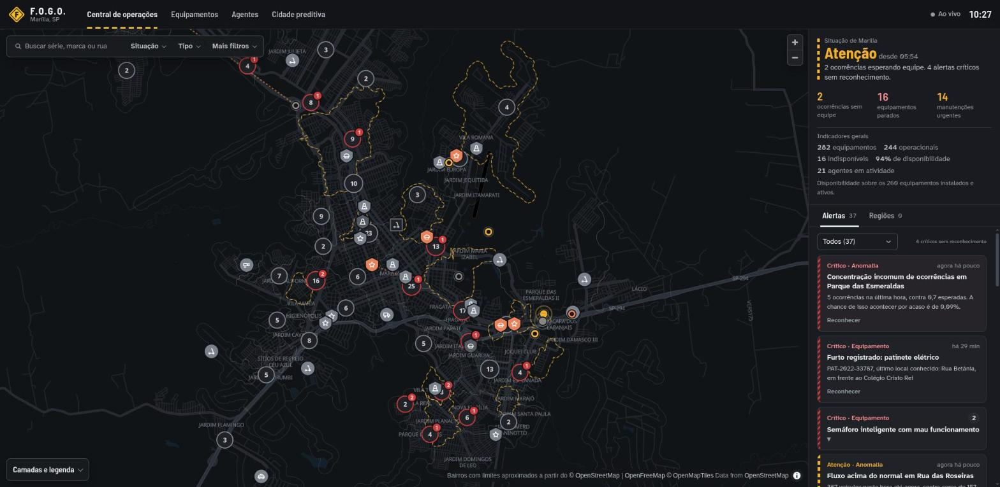
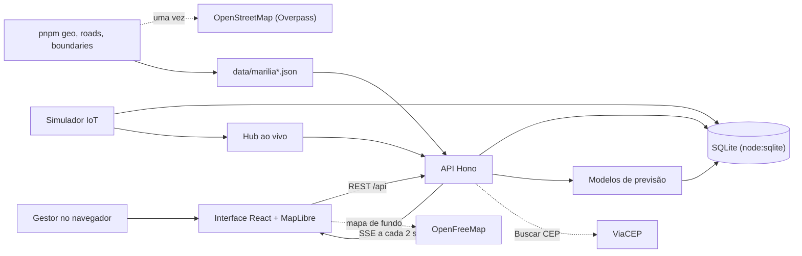

# F.O.G.O.

Ferramenta Onisciente de Gestão e Operações: um sistema para a prefeitura de Marília (SP) cadastrar os equipamentos e agentes de trânsito e segurança, acompanhar a cidade em tempo real e antecipar problemas. Feito para a Etapa Bônus do DSIN Coder Challenge 2026.



O projeto cobre as três partes do desafio:

1. Inventário: cadastro de equipamentos (12 tipos, cada um com suas características) e de agentes.
2. Central de operações: mapa ao vivo, indicadores gerais, filtros, alertas e situação de cada região.
3. Cidade preditiva: ocorrências esperadas por bairro, reforço de agentes, comportamentos fora do padrão, risco de falha dos equipamentos e tendências.

## Como rodar

Com Docker:

```sh
docker compose up --build
```

Sem Docker, com Node.js 24 ou mais recente e pnpm 10:

```sh
pnpm install
pnpm build
pnpm start
```

Depois abra http://localhost:3210.

Na primeira execução o servidor cria o banco SQLite em `data/fogo.db` e gera 120 dias de histórico. Isso leva cerca de um segundo. Para começar do zero, use `pnpm start:fresh`. A rota `/api/health` responde quando o servidor e o banco estão de pé, e é ela que o `HEALTHCHECK` do contêiner usa.

Para desenvolver com recarga automática, rode `pnpm dev` e abra http://localhost:5173.

O mapa de ruas vem do OpenFreeMap e precisa de internet. Sem conexão, o sistema continua funcionando e mostra só os bairros e os marcadores sobre fundo liso.

## Roteiro de demonstração (2 minutos)

1. Abra a Central. No painel da direita, leia a situação de Marília (normal, atenção ou crítico) e o motivo, os três números de ação e os indicadores gerais: total de equipamentos, operacionais, indisponíveis, disponibilidade e agentes em atividade.
2. Clique em "equipamentos parados": o mapa passa a mostrar só eles. Clique de novo para voltar. Abra "Camadas e legenda" para ver o que cada forma, cor e padrão quer dizer.
3. Clique num marcador de equipamento, num agente e numa ocorrência para abrir os detalhes, com histórico e telemetria das últimas 48 horas.
4. Na aba Alertas, localize um alerta no mapa pelo título e reconheça outro. Na aba Regiões, veja quais regiões e bairros pedem atenção. A aba Atividade resume o que mudou desde a sua última visita e lista as últimas 24 horas. Clique num bairro no mapa para ver os equipamentos parados e os agentes livres mais próximos, com o tempo estimado de chegada.
5. Em Equipamentos, clique num tipo de "Parados por tipo", filtre por situação e abra a ficha de um item. Cadastre um equipamento novo: o botão "Buscar CEP" preenche o endereço e o clique no mapa ajusta o ponto e o bairro.
6. Em Cidade preditiva, troque o horizonte em "Próximas horas", clique num bairro marcado como acima do normal e leia o número esperado, a faixa e o motivo. Passe pelas abas Fora do padrão, Equipamentos e Tendências.


## O que tem em cada parte

### Inventário

Cada equipamento guarda número de série, marca, modelo, órgão responsável, situação, data de instalação, endereço completo (CEP, rua, referência como "KM 12" ou "em frente ao Supermercado X", bairro, cidade e UF), coordenadas GPS, necessidade de manutenção (nenhuma, agendada ou imediata), periodicidade e datas da última e da próxima manutenção.

As características mudam conforme o tipo. Um radar tem o tipo de fiscalização e a velocidade máxima; uma câmera tem visão noturna, resolução, imagem colorida ou preto e branco, PTZ e leitura de placas; um veículo de transporte tem serviço (táxi, mototáxi ou escolar), placa e alvará. Os tipos e seus campos ficam em `src/shared/catalog.ts`, e o mesmo catálogo gera o formulário e a validação no servidor.

O botão "Buscar CEP" preenche rua, bairro e coordenadas, primeiro pela base local e depois pelo ViaCEP. O ponto pode ser ajustado clicando no mapa ou arrastando o marcador, e o bairro acompanha o ponto.

Os agentes (agentes de trânsito, guardas municipais e policiais militares) têm matrícula, graduação, turno, base, situação e o veículo que usam.

As listas de equipamentos e de agentes têm a mesma estrutura: uma linha curta de atalhos (os tipos com algo parado, ou o efetivo por situação), uma barra de filtros e uma tabela de largura total. A manutenção aparece como "amanhã", "em 5 dias" ou "vencida há 12 dias", com cor só quando vence em até 7 dias.


### Central de operações

O mapa ocupa quase toda a tela e mostra:

- os bairros que pedem atenção com contorno tracejado, como faixa de pista, e os críticos com zebrado vermelho;
- os equipamentos agrupados quando estão próximos, com um selo vermelho que conta os parados de cada grupo e um selo com chave inglesa nos que precisam de manutenção urgente ou nos próximos 7 dias;
- os agentes em serviço, com um símbolo por função (cone para agente de trânsito, estrela para guarda municipal, quepe para policial militar) e uma linha pontilhada até a ocorrência que atendem;
- as ocorrências abertas, que pulsam enquanto esperam equipe;
- um mapa de calor opcional das ocorrências dos últimos 30 dias.

A interface usa a linguagem da sinalização viária. O zebrado marca o que é crítico e o tracejado marca o que pede atenção. Só os problemas ganham cor: equipamentos operacionais e agentes disponíveis ficam em cinza, como recomenda a norma ISA-101 para telas de salas de controle. A forma do marcador também indica a situação do equipamento, como nas placas de trânsito, para que a informação não dependa só da cor: círculo para operacional, losango para mau funcionamento, quadrado para manutenção, octógono para furtado e contorno para não instalado ou desativado.

A barra de filtros fica sobre o mapa, com busca, situação, tipo e, em "Mais filtros", região, bairro, órgão e manutenção. O painel da direita começa pela situação de Marília e o motivo em uma frase, ideia tirada dos estágios operacionais do Centro de Operações do Rio. Logo abaixo vêm as ocorrências sem equipe, os equipamentos parados e as manutenções urgentes (os dois últimos filtram o mapa) e os indicadores gerais. O painel tem uma aba de alertas e outra com a situação de cada região.

Os níveis seguem a ideia de que só pede atenção o que pede ação:

- um bairro ou região fica crítico com ocorrência crítica sem equipe, duas ou mais ocorrências graves sem equipe ou disponibilidade de equipamentos abaixo de 60%;
- fica em atenção com uma ocorrência grave sem equipe, disponibilidade abaixo de 85% ou ocorrências acumuladas (no bairro, 2 graves em atendimento ou 3 abertas; na região, 4 e 10);
- a cidade fica crítica quando alguma região está crítica ou há ocorrência crítica esperando equipe, e pede atenção quando alguma região pede, quando alguma ocorrência espera equipe ou quando há alerta crítico ainda não reconhecido. Um bairro com concentração incomum de ocorrências na última hora fica em atenção.

Os alertas seguem a norma ISA-18.2: crítico é o que pede ação agora, como ocorrência sem equipe, semáforo apagado ou concentração incomum de ocorrências. Um crítico ativo há mais de 24 horas vira aviso. Alertas iguais de equipamento e manutenção aparecem agrupados, e cada item do grupo pode ser localizado no mapa e reconhecido.

Os dados chegam por Server-Sent Events a cada 2 segundos. Um simulador faz o papel dos dispositivos IoT: movimenta agentes e veículos, gera ocorrências segundo o padrão histórico de cada bairro, despacha o agente disponível que chega mais rápido, registra falhas, reparos, manutenções preventivas, furtos, reposições e quedas de comunicação, e acumula as contagens dos sensores. Para a demonstração ter movimento, ocorrências e falhas acontecem 20 vezes mais rápido que na vida real, com as mesmas taxas por equipamento do histórico. Os modelos de previsão descontam essa aceleração.

O deslocamento não é acelerado e segue as ruas. Agentes a pé andam a 4,5 km/h na ronda e a 7 km/h a caminho de uma ocorrência. Viaturas e motos patrulham a 30 km/h e vão a um chamado a até 60 e 65 km/h. Táxis e mototáxis rodam a 40 km/h, o veículo de fiscalização a 15 km/h e os patinetes a 15 ou 20 km/h, conforme o limitador. Veículos respeitam a mão de direção e o limite de cada trecho; só viaturas e motos em atendimento passam um pouco do limite. O despacho só considera quem chega em até 20 minutos.

### Cidade preditiva

A página tem uma aba por pergunta, e cada bloco diz o que está sendo previsto, como usar o resultado e, recolhido, com quais dados. Os modelos aprendem com os dados do banco; nenhum deles consulta o gerador de dados.

- Próximas horas, ocorrências esperadas por bairro: combina a participação de cada bairro em cada tipo de ocorrência, o padrão da cidade por dia da semana e hora (12 semanas, com peso maior para as recentes) e a tendência das duas últimas semanas, e aumenta quando câmeras, radares ou semáforos do bairro estão parados. Cada bairro mostra o número esperado e a faixa em que ele cai em 8 de cada 10 dias parecidos. O mapa marca só os bairros acima do próprio normal para aquele dia e horário: tracejado a partir de 20% acima, zebrado a partir de 50%.
- Próximas horas, reforço de agentes: compara a carga prevista de cada região (ocorrências vezes o tempo médio de atendimento) com o efetivo ativo, mostra o saldo de cada uma e sugere remanejamentos.
- Próximas horas, padrão semanal: um mapa de calor com as ocorrências esperadas por dia e hora.
- Próximas horas, qualidade do modelo: um teste retroativo treina o modelo sem os últimos 7 dias e compara a previsão com o que aconteceu. Na base de demonstração, medida em 23/10/2026 em seis janelas de 7 dias com duas sementes, os 10% de blocos de 4 horas apontados como mais arriscados concentram entre 15% e 22% das ocorrências, contra 11% a 16% da média histórica simples. O erro por região fica entre 7% e 21% menor. A tela mostra o teste da janela mais recente.
- Fora do padrão: sensores com leitura zerada, quedas e picos de fluxo (escore z contra o mesmo horário das quatro semanas anteriores) e concentrações de ocorrências (teste de Poisson contra o esperado).
- Equipamentos, risco de falha em 7 dias: estima, pelo histórico, a taxa de falha de cada tipo de equipamento e quanto a manutenção vencida aumenta essa taxa. Com isso monta a fila de manutenção preventiva.
- Tendências: disponibilidade por tipo de equipamento com projeção de 30 dias e a faixa em que ela deve ficar em 8 de cada 10 casos, ocorrências por região e uso de totens, cancelas e sensores de fluxo. Dias em que o servidor ficou desligado não contam como queda. Só viram aviso as variações estatisticamente significativas.

## Arquitetura



O servidor é um único processo Node.js que roda direto dos arquivos `.ts`. Ele serve a API, a interface já compilada e o fluxo ao vivo, e roda o simulador no mesmo processo. Os modelos de previsão são funções puras que recebem os registros do banco e guardam o resultado em cache por alguns minutos.

## Dados

Os bairros, ruas e pontos de referência de Marília vêm do OpenStreetMap (licença ODbL), e os CEPs foram conferidos no ViaCEP. A base fica em `data/marilia.json` e `data/marilia-roads.json` e é refeita em três passos, nesta ordem, todos com internet. `pnpm geo` busca bairros, ruas, CEPs e pontos de referência e leva uns quatro minutos por causa do intervalo entre consultas ao ViaCEP. `pnpm roads` baixa a malha viária, com mão de direção e limite de velocidade de cada trecho, usada no deslocamento dos agentes. `pnpm boundaries` desenha os limites dos bairros.

Não existe base aberta com os limites oficiais dos bairros de Marília, então os limites do F.O.G.O. são aproximados e não valem como divisa legal. Cada rua fica com o bairro mais próximo pela malha viária, e a área em volta das ruas é dividida a partir daí, sem atravessar rios, córregos e a ferrovia. Os seis bairros e distritos que têm polígono no OpenStreetMap (Jardim Vitória, Jardim Vista Alegre, Lácio, Padre Nóbrega, Jardim Julieta e Oswaldo Fanceli) usam esse polígono, sem tomar a área dos bairros que ficam dentro deles.

As licenças e os créditos de cada fonte estão em [DATA.md](DATA.md).

Equipamentos, agentes, histórico de ocorrências e telemetria são simulados. O gerador cria padrões que um sistema real teria: picos de trânsito no começo da manhã e no fim da tarde, mais ocorrências de segurança nas noites de sexta e sábado, bairros comerciais com mais estacionamento irregular, equipamentos com manutenção atrasada falhando mais, uma frota de patinetes envelhecendo e alguns bairros com ocorrências em alta nas últimas semanas. A parte preditiva precisa descobrir esses padrões sozinha.

## Configuração

| Variável               | Padrão         | Uso                                                     |
| ---------------------- | -------------- | ------------------------------------------------------- |
| `PORT`                 | `3210`         | Porta HTTP                                              |
| `FOGO_DB`              | `data/fogo.db` | Caminho do banco SQLite                                 |
| `FOGO_LIVE_MULTIPLIER` | `20`           | Aceleração de ocorrências e falhas na simulação ao vivo |
| `FOGO_SIMULATION`      | ligada         | Use `off` para desligar o simulador                     |
| `FOGO_SEED`            | `20261027`     | Semente do gerador de dados                             |

## Código e testes

TypeScript nos dois lados. O servidor usa Hono, o SQLite embutido no Node.js (`node:sqlite`) e Zod para validação. A interface usa React, Vite e MapLibre GL, com gráficos em SVG feitos à mão.

```
src/shared/   tipos, catálogo de equipamentos, geografia, horário e plural em português
src/server/   API, banco, simulador, gerador de dados (seed/) e modelos de previsão (predictions/)
src/web/      interface: páginas em pages/, componentes em components/, mapa em map/
scripts/      geração da base geográfica, malha viária e limites de bairro, e servidor de desenvolvimento
data/         base geográfica e malha viária de Marília (o banco também fica aqui)
docs/         capturas de tela e a pesquisa que orientou a interface
```

```sh
pnpm check    # formatação, lint, tipos e testes
pnpm test     # só os testes
```

São cerca de 200 testes com Vitest: regras de alerta e de nível, modelos de previsão com dados sintéticos (inclusive séries com lacuna), simulador, semente, API, limites de bairro e as funções de formatação e filtro da interface. Os hooks do prek rodam formatação, lint e tipos a cada commit e os testes a cada push (`prek install --hook-type pre-commit --hook-type pre-push`). O GitHub Actions roda `pnpm check`, o build e o `docker build` a cada push.

## Limitações

- Equipamentos, agentes, ocorrências e telemetria são simulados, e os modelos foram avaliados nessa base. Com dados reais, os limiares e a qualidade precisariam ser medidos de novo.
- Não há autenticação nem perfis de acesso.
- Tudo roda num único processo com SQLite, suficiente para uma cidade do porte de Marília, mas sem escala horizontal.
- O mapa de fundo depende de internet; sem ela aparecem só os bairros e os marcadores.
- Os limites de bairro são aproximados (ver Dados).

## Uso de IA

O projeto foi desenvolvido com o Claude Code, usando o modelo Claude Opus 5.5, da Anthropic. As instruções dadas ao assistente (comandos, regras de código e da interface, convenções do domínio) estão em `CLAUDE.md` e na pasta `.claude/`.
