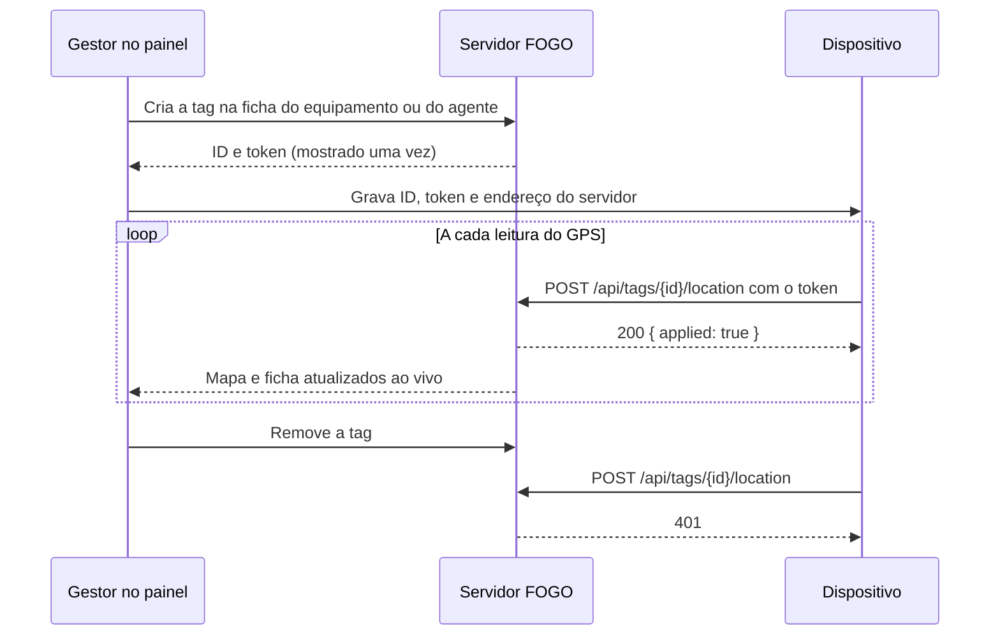

# Rastreadores

Um dispositivo físico, como um GPS veicular, uma placa ESP32 com módulo GPS ou um celular, pode informar ao FOGO onde está um equipamento ou um agente. No modo simulação, quem move os cadastros sem rastreador é o simulador. Com rastreador, a posição passa a vir do dispositivo e o simulador deixa aquele cadastro em paz.

## Como funciona

Cada dispositivo recebe uma tag, que fica vinculada a um equipamento ou a um agente do painel. A tag tem duas partes:

- o ID, como `TAG-7F3K9QWD`, que vai no endereço e pode aparecer em telas e registros;
- o token, uma sequência aleatória que funciona como senha do dispositivo. O painel mostra o token uma única vez, logo depois de criar a tag. O banco guarda só o hash dele.



## Passo a passo

1. Abra a ficha do equipamento (Equipamentos, clique no número de série) ou do agente (Agentes, clique no nome).
2. No quadro Rastreador, clique em "Criar tag".
3. Copie o token e o endereço que aparecem e grave os dois no dispositivo. Ao sair da página, o token some e não há como recuperá-lo.
4. Ligue o dispositivo. A primeira leitura aceita já aparece em "Última leitura" e move o marcador na Central.
5. Para trocar o dispositivo ou se o token vazar, clique em "Remover tag" e crie outra. A tag antiga deixa de ser aceita na hora.

Cada equipamento ou agente aceita uma tag por vez.

## A rota

```
POST /api/tags/{id}/location
Authorization: Bearer {token}
Content-Type: application/json
```

Corpo:

| Campo     | Tipo   | Obrigatório | O que é                                                           |
| --------- | ------ | ----------- | ----------------------------------------------------------------- |
| `lat`     | número | sim         | Latitude em graus decimais, de -90 a 90                           |
| `lng`     | número | sim         | Longitude em graus decimais, de -180 a 180                        |
| `battery` | número | não         | Carga da bateria em %, de 0 a 100. Vale só para equipamentos      |
| `at`      | texto  | não         | Hora da leitura em ISO 8601 com fuso, como `2026-10-26T14:03:00Z` |

Sem `at`, o servidor usa a hora em que recebeu a leitura. Uma hora no futuro é trocada pela hora do servidor.

Respostas:

| Código | Corpo                                             | Quando                                                  |
| ------ | ------------------------------------------------- | ------------------------------------------------------- |
| 200    | `{ "applied": true, "at": "..." }`                | Leitura aceita                                          |
| 200    | `{ "applied": false, "reason": "..." }`           | `at` é anterior à última leitura aceita; nada muda      |
| 401    | `{ "error": "Tag ou token inválido" }`            | Sem token, token errado, tag removida ou ID inexistente |
| 422    | `{ "error": "Dados inválidos", "issues": [...] }` | Campo faltando ou fora do intervalo; `issues` diz qual  |

O 401 é o mesmo para tag inexistente e para token errado, de propósito: quem tenta adivinhar não descobre quais IDs existem.

## O que cada leitura muda

- Veículos, patinetes e outros equipamentos móveis: a posição atual e a bateria mudam, e a última comunicação passa a ser a hora da leitura.
- Equipamentos fixos (câmera, radar, semáforo e outros): o ponto cadastrado não muda, porque quem decide onde o equipamento está instalado é o cadastro. A leitura conta como sinal de vida e atualiza a última comunicação e a bateria.
- Agentes: a posição e a última comunicação mudam.

A Central recebe a mudança pelo fluxo ao vivo no mesmo instante.

## Frequência

- Equipamento fixo em operação aparece como "sem comunicação" depois de 3 minutos sem leitura. Mande pelo menos uma leitura por minuto.
- Para veículos e agentes em movimento, uma leitura a cada 5 a 15 segundos deixa o mapa fluido. Parado, uma por minuto basta.

## Sem rede

Se o dispositivo perder a conexão, ele pode guardar as leituras e reenviar depois, em ordem e com o campo `at` preenchido com a hora do GPS. Leituras mais antigas que a última aceita voltam com `applied: false` e podem ser descartadas.

## Segurança

- Em produção, sirva o FOGO por HTTPS. O token viaja no cabeçalho, e em HTTP puro qualquer um na mesma rede consegue lê-lo.
- Grave o token em memória que não saia junto com logs ou atualizações de firmware.
- Um token vazado só permite mandar posições daquela tag. Remova a tag e crie outra.

## Exemplo com curl

```sh
curl -X POST http://localhost:3210/api/tags/TAG-7F3K9QWD/location \
  -H "Authorization: Bearer SEU_TOKEN" \
  -H "Content-Type: application/json" \
  -d '{"lat": -22.2139, "lng": -49.9458, "battery": 87}'
```

## Exemplo com ESP32 e GPS

Usa um ESP32 com um módulo GPS serial (NEO-6M ou parecido) ligado nos pinos 16 e 17, e as bibliotecas TinyGPSPlus e ArduinoJson. Troque rede, senha, endereço, ID e token pelos seus.

```cpp
#include <WiFi.h>
#include <HTTPClient.h>
#include <TinyGPSPlus.h>
#include <ArduinoJson.h>

const char* WIFI_SSID = "minha-rede";
const char* WIFI_PASSWORD = "senha-da-rede";
const char* SERVER = "https://fogo.exemplo.gov.br";
const char* TAG_ID = "TAG-7F3K9QWD";
const char* TAG_TOKEN = "SEU_TOKEN";
const unsigned long SEND_EVERY_MS = 10000;

TinyGPSPlus gps;
HardwareSerial gpsSerial(2);
unsigned long lastSent = 0;

void connectWifi() {
  WiFi.begin(WIFI_SSID, WIFI_PASSWORD);
  while (WiFi.status() != WL_CONNECTED) {
    delay(500);
  }
}

String isoTime() {
  char buffer[25];
  snprintf(buffer, sizeof(buffer), "%04d-%02d-%02dT%02d:%02d:%02dZ",
           gps.date.year(), gps.date.month(), gps.date.day(),
           gps.time.hour(), gps.time.minute(), gps.time.second());
  return String(buffer);
}

void sendLocation() {
  JsonDocument body;
  body["lat"] = gps.location.lat();
  body["lng"] = gps.location.lng();
  if (gps.date.isValid() && gps.time.isValid()) {
    body["at"] = isoTime();
  }
  String payload;
  serializeJson(body, payload);

  HTTPClient http;
  http.begin(String(SERVER) + "/api/tags/" + TAG_ID + "/location");
  http.addHeader("Content-Type", "application/json");
  http.addHeader("Authorization", String("Bearer ") + TAG_TOKEN);
  int status = http.POST(payload);
  Serial.printf("POST %d %s\n", status, http.getString().c_str());
  http.end();
}

void setup() {
  Serial.begin(115200);
  gpsSerial.begin(9600, SERIAL_8N1, 16, 17);
  connectWifi();
}

void loop() {
  while (gpsSerial.available() > 0) {
    gps.encode(gpsSerial.read());
  }
  if (WiFi.status() != WL_CONNECTED) {
    connectWifi();
  }
  if (gps.location.isValid() && millis() - lastSent >= SEND_EVERY_MS) {
    lastSent = millis();
    sendLocation();
  }
}
```

Com bateria, mande também `body["battery"]` com a carga lida do divisor de tensão.

## Simulador e rastreadores juntos

O simulador continua cuidando de quem não tem tag. Um cadastro com tag não é movido por ele, e equipamentos com tag não recebem o sinal de vida simulado, então o alerta "sem comunicação" passa a refletir o dispositivo de verdade. Para rodar só com dispositivos reais, use o modo produção (`pnpm start`), que não liga o simulador. O [docs/production.md](production.md) explica os dois modos.
